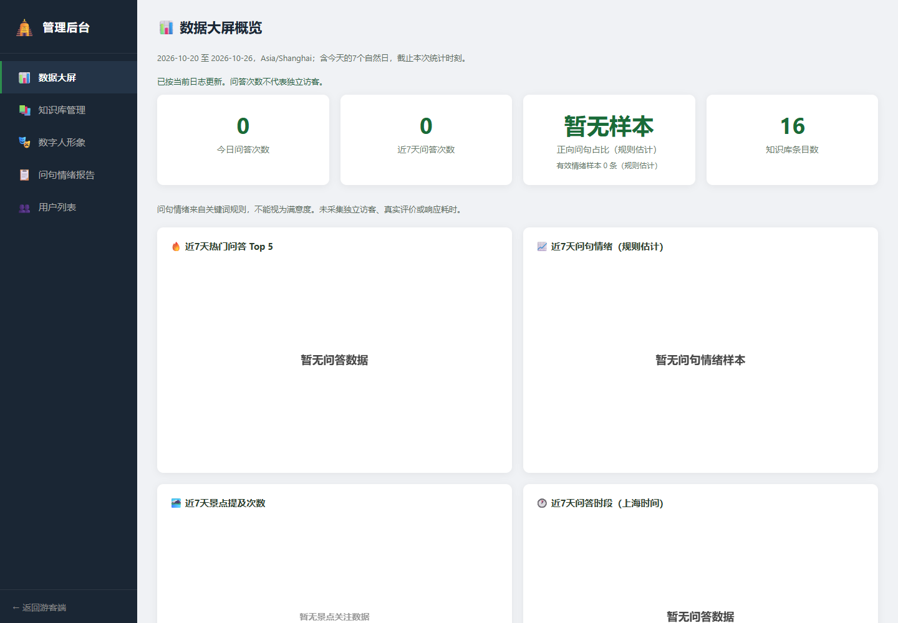
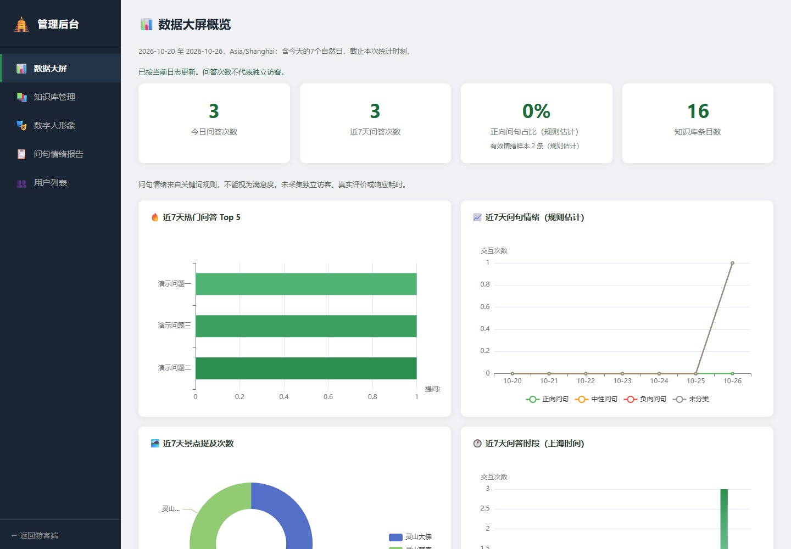

# REQ-034 / GitHub #13：可解释的后台统计

用户要求继续处理未完成议题。当前无前置依赖、未被组员认领的 #13 本轮实施。本分支从 main 独立开发，不包含尚待合并的 #15、#16、#18；这些 PR 的交付不被撤销。

## 问题与产品决定

原版无数据给出95%满意度，页面把有效0值再次替换成95；问答日志条数被称为访客量；所谓本周包含今天及此前七天共八天。此轮只报告现有数据能支持的口径，不新增打分/评价收集，不推算独立访客或响应时间。

页面四张卡：今日问答次数、近7天问答次数、正向问句占比（规则估计）、知识库条目数。问句占比显示有效情绪样本数；无有效样本显示“暂无样本”，0%是有效值。固定说明“问句情绪来自关键词规则，不能视为满意度；未采集独立访客和真实评价”。图表与建议同样不能暗示真实满意度或实际到访。

## 日期与样本定义

- 时区统一Asia/Shanghai。近7天为含今天的七个自然日，即today-6至today；截取范围起点当天00:00，截止本次统计时刻。未来日志（包括今天稍后的时间）、非正时间戳、null条目忽略，不计入实际次数。
- 问答次数按有效日志条数，不按用户/会话去重；相同会话多次提问仍是多次问答。现有日志没有可靠会话身份，不生成独立访客数。
- 情绪有效样本仅positive/neutral/negative三个现有标记，不重新计算旧日志标签。正向问句占比=positive/有效情绪样本数×100，保留两位小数；分母为0时null。
- 未知/null情绪归为unclassified，计入问答次数、不计入有效情绪样本。趋势每天返回positive/neutral/negative/unclassified/total，图表显示四类，不能把未知样本偷偷算中性。
- 热门问答、景点提及排名、时段分布与服务建议统一近7天窗口；未来/过期记录不进入图表或建议。图表说明“次数/提及”，不宣称独立游客。

## API-034 契约

GET /api/admin/dashboard：保留知识库和图表字段，新增数值todayInteractions、last7DaysInteractions、sentimentSampleCount，nullable Double positiveQuestionRate；新增字符串periodStart/periodEnd（ISO日期）、timezone固定Asia/Shanghai、estimated=true。旧todayVisitors/weekVisitors/satisfactionRate/avgResponseTime字段保留但返回null，表示未采集，不用伪造的数值兼容旧含义。页面只读取新口径字段。

GET /api/admin/reports/sentiment：trend与以上positiveQuestionRate/sentimentSampleCount/periodStart/periodEnd/timezone/estimated，旧satisfactionRate=null；另含同一快照的topics与suggestions，报告页一次读取并整体展示。旧topics/suggestions端点仍可单独使用、沿用结构但采用上述窗口。建议若提到负向词比例，必须称问句规则估计，不能归因游客不满意。

统计使用Clock依赖以固定时区边界测试。默认时钟为系统时钟，测试传固定Clock。一次dashboard快照使用一致的时刻和日志副本，避免重复调用跨午夜/并发新增时出现分子分母不一致。保留logInteraction现有调用入口及JSON字段，不写入历史用户/聊天数据、不改变认证策略。旧命名服务方法可保留为deprecated兼容转发，但不再用于输出伪访客/满意度。

## 页面验收

1. 新/空数据：今日与近7天为0，正向占比“暂无样本”，样本0；无95或虚构圆环/柱形样本；真实评价未采集有说明。
2. 中性/负向样本但无正向：0%正确展示；未知标签样本不影响分母；样本数与规则标签可见。
3. 加载失败：卡片显示不可用，不把HTTP失败当空数据；显示错误状态。旧图表不得伪装刚刷新成功。
4. 图表显式标近7天与上海时区，情绪标规则估计；当前报表与仪表盘均不称满意度/服务人次。
5. 后端与页面分别验证空数据、零值、同一会话多条日志、今天午夜/六天前边界/第八天/未来日志；可控时钟与临时合成数据，不调用模型。

## 验证与协作

后端执行Maven clean verify（切分支后清除其他PR遗留target测试类）；前端以Node执行真实页面脚本/统计格式化测试；执行文档链接及隔离JAR HTTP检查。浏览器用隔离合成日志验证空状态及0%，不读取开发者历史交互文件。API新旧字段语义在Issue #13与本文件提前明确；未来合并其他PR时重跑对应回归。

## 本轮证据（2026-10-26）

- 本独立分支17项Java测试、9项前端测试通过；不把其他待合并PR的测试计入本分支。Codex已亲自执行离线Maven verify、Node检查、文档链接和最终JAR隔离HTTP检查。
- HTTP检查在空日志时验证0次/0样本/null比例及旧字段全null；一次离线问答后验证1次/1样本/0%，并核对报告窗口一致。原景点、离线导览及Live2D资源检查继续通过。
- 浏览器1440×1000：空数据为“暂无样本”；三条合成有效问答（中性、负向、未知各一）为3次、2条有效情绪样本、0%。另有过期/未来/无效时间/null记录，均未混入当前计数。报告页面仍显示2样本与0%，三面板来自同一快照。
- Standards与Spec评审无新增发现。Codex复查发现JSON锁外保存仍可能交错，已反馈修正为同锁串行落盘，并新增concurrentLoggingAndFlushKeepJsonComplete测试，100条并发合成日志不缺失且文件可解析。
- Codex决定统计/交互契约并完成页面，DeepSeek Harness实现后端及测试，Codex核对实际代码、反馈修正并独立验证。未读取开发者真实历史记录，不伪造用户或满意度数据。

合并提示：本PR从main独立，未包含认证/创意PR。与 #15 的AdminController、工作流、测试依赖和HTTP检查有重叠；与 #18 的AnalyticsService调用、测试和文档有交集，合并后需重新跑双方回归。接口旧字段改null属于有意的语义更正，旧客户端需迁移，不能继续把null替换为95。
