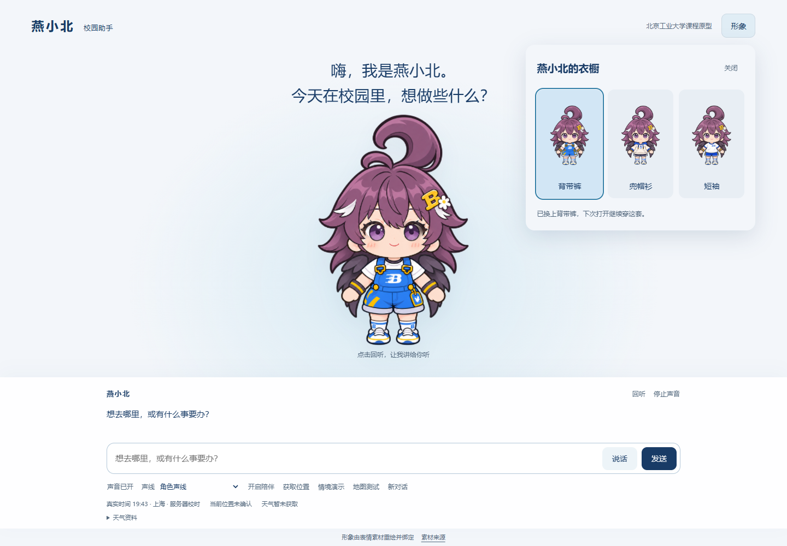

# 校园助手运行复查

2026年11月16日，用户要求启动软件并检查不足，随后指定优先完善Q版形象与自选换装。现已完成REQ-064，复查同时保留原业务界面的后续改进依据。

## 本轮完成

三套v8可动形象采用细腿、小鞋设计并已进入校园页。衣橱支持本机选择记忆、连续切换、失败重试、静态备用图、关闭及键盘操作。手机成功选择后自动收起面板，方便看到完整人物与声音控件。三套生成原图及提示词、保护区导入和运行资源摘要均已保存。[形象说明](campus_avatar.md#L45)、[切换实现](../src/main/resources/static/js/campus-avatar.js#L179)、[衣橱交互](../src/main/resources/static/js/campus-appearance.js#L7)。

| 桌面衣橱 | 手机效果 |
|---|---|
|  |  |

## 后续优先项

1. 手机进入办事或图书馆场景后，对话区高约481～516px，主场景只剩235～269px。完整规则还会在上下区域重复出现。应精简对话确认，将完整资料集中到主场景，并整理常驻控制。[回复呈现](../src/main/resources/static/js/campus.js#L77)、[场景事项](../src/main/resources/static/js/campus-scene.js#L181)。
2. 找路结果应优先呈现起点、目的地与外部地图动作。当前先出现大照片，路线摘要与动作在后面。实际入口、可通行路网与餐饮营业和评分资料仍需逐项核验。[场景顺序](../src/main/resources/static/js/campus-scene.js#L141)、[路线摘要](../src/main/resources/static/js/campus-scene.js#L145)、[地图动作](../src/main/resources/static/js/campus-scene.js#L162)。
3. 当前18089运行的是空模型Key的本地资料演示。默认角色声线请求遇到401后回退系统声音。需要配置真实模型和独立语音服务，并完成登录、合成与设备听感验收。[运行条件](campus_demo_runbook.md#L72)、[语音状态](../src/main/resources/static/js/campus-voice.js#L17)。
4. 手机环境文字为10px，部分旧辅助按钮高30px。地图地点图形缺少独立可识别的键盘入口。后续应提升可读性和触点，并为地点提供文本入口。[手机环境样式](../src/main/resources/static/css/campus.css#L294)、[地图地点标记](../src/main/resources/static/js/campus-map.js#L126)。

## 验证与边界

本轮完整前端375项通过，Java318项通过，v8资产3项通过，文档链接检查通过，独立打包JAR的校园及景区HTTP冒烟通过。HTTP检查逐项核对三套衣装69份运行文件SHA-256。真实浏览器验证1440×1000、390×844、刷新恢复、快速连续操作、对话中换装、真实系统语音播报中换装、停止、减少动态效果及WebGL上下文丢失后的静态降级和再换装恢复。[回归入口](test_reference.md#L1)、[HTTP资源检查](../scripts/smoke_teacher_project.py#L257)。

手机为Chromium视口模拟。真实手机GPS、麦克风、角色声音听感、联网DeepSeek工具调用与校内实地路网继续按设备及资料验收。衣橱区域axe 4.12.1检测0项violations，0项incomplete。

## 评估来源与执行记录

目标为 `src/main/resources/static/campus.html`，slug为 `src-main-resources-static-campus-html`。使用Impeccable的独立A/B流程，A在接触检测器之前完成设计评价，B单独运行CLI检测和浏览器取证。父代理收到A后读取B并综合。未发现ignore清单。初始界面Nielsen十项分别为3、3、3、3、3、2、2、2、3、2，共26/40，认知负担8项中3项未通过。该评分对应换装开发前的整体任务界面。

CLI扫描报告1条待定位hover对比度信号及3条手机10px状态文字，后者由实际计算样式确认。B临时overlay自身触发的region误报已排除，第三方地图署名小字和无法定位的hover信号保留人工判断。A/B均使用自己的会话，B注入过临时overlay并已停止8400辅助服务、重载清除注入。运行中的Java演示服务继续提供页面。

增量复核使用独立设计检查及主代理浏览器。一次测试会话命名碰撞后立即分开，受影响步骤重新执行。临时截图、CLI结果、测试及构建日志位于本地target，正式预览保存到本页。未把检查脚本错误、工具overlay或自动语音限制计为产品功能故障。上层任务已明确范围，本轮按既定产品资料执行复查。
