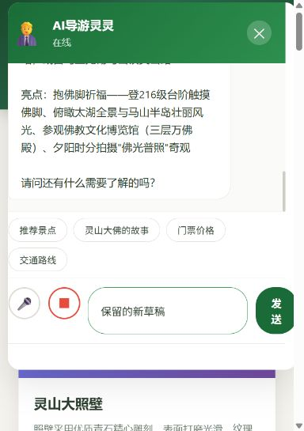

# 聊天请求可靠性（REQ-031 / GitHub #6）

## 行为与接口

文字、回车、快捷问题、Web/Android 识别结果统一经过发送入口。同一时刻只接受一个提问。默认总时限为 30 秒，包括 transport 的前置步骤和 response.json()，不是只等 HTTP 响应头。

状态：idle → pending → succeeded / failed / cancelled。pending 期间发送、快捷与语音入口禁用，但输入框仍可编辑新草稿；“取消等待”独立于“停止说话”。关闭面板也取消等待并使延迟语音发送失效。

网络、非成功 HTTP、无效 JSON、空回复、超时和取消都会恢复操作、移除 typing、保留原问题与兴趣快照。只有用户点击“重试上一个问题”才重试，不重复添加用户气泡，不覆盖新草稿。新问题被接受后清理旧重试状态。

每个请求使用独立对象身份隔离回调：取消、超时后，无论旧网络/解析最终成功或失败，都不能渲染旧回复、路线或播报，也不能改变新请求的控件状态。AbortController 用于尽可能取消传输；**取消浏览器等待不保证后端模型停止计算**，手动重试可能产生新的服务端请求。

## 模块职责

- [请求控制 chat-request.js:L21](../src/main/resources/static/js/chat-request.js#L21)：注入 request、onStart、onState、onSuccess 与可选计时器；提供 send/retry/cancel/isPending/getState。send/retry 返回是否接纳；状态快照不暴露内部请求。
- [页面 main.js:L1](../src/main/resources/static/js/main.js#L1)：DOM、入口与语音适配，不改变后端协议。若存在 AuthGuard 则使用其 apiFetch，否则使用 fetch，传递同一 AbortSignal。
- [页面结构 index.html:L1](../src/main/resources/static/index.html#L1)：加载控制模块、等待状态、取消与重试按钮，状态使用 aria-live。
- [行为测试 chat-request.test.js:L1](../tests/frontend/chat-request.test.js#L1)、[页面测试 chat-main.test.js:L1](../tests/frontend/chat-main.test.js#L1)：执行真实脚本，网络、DOM、语音与计时器为可控替身。

## 验收与演示证据

执行：`node --test tests/frontend/*.test.js`。聊天稳定性 PR #16 的 24 项测试通过，分为控制模块 15 项、页面适配 9 项，不计入未合并 #15 的认证测试；叠加创意分支的新增检查见 TEST-032。

| 场景 | 可重复的操作 | 预期 |
|---|---|---|
| 慢响应 | 请求未结束时连续点击/回车/快捷/语音 | 单请求、单等待指示，不清新草稿或重复停止播报 |
| 网络失败 | 拒绝可控 fetch Promise，点击重试 | 显示失败，重试原问题，不追加重复问题气泡 |
| 解析卡住 | 返回响应头但让 json Promise 保持 pending；虚拟时钟前进 30 秒 | 超时恢复操作，迟到解析结果不渲染 |
| 取消/关闭 | 挂起请求后取消或关闭，再发送新问题，最后完成旧请求 | 旧回复与旧错误均不干扰新请求 |
| 重新开麦 | 识别结束后 200ms 内再次开启语音，再结束本轮识别 | 旧识别延迟发送失效，新一轮聆听不被打断 |
| 草稿保护 | 失败后输入新草稿，再重试旧问题；或识别后编辑文字 | 原问题重试，新草稿保留，过期语音不替换草稿 |

可在浏览器开发工具中阻止 /api/chat 或模拟慢网络观察相同状态。自动化证明来自 Node vm。另在本机浏览器的隔离测试数据环境验证了提问后禁用入口、展示离线知识回复、恢复按钮及保留新草稿，见下图。未验证 Android 真机或真实付费模型。

## 开发边界与分支

从 main 基准 53bb2ae 独立实现，#15 认证 PR 仍待评审。本分支不包含其权限改动，也不实现 #7 口型同步、#8 配置、#9 数据或多轮对话。两项都修改 main.js、index.html、工作流和部分文档，合并第二项时需同步并重跑两套测试。
