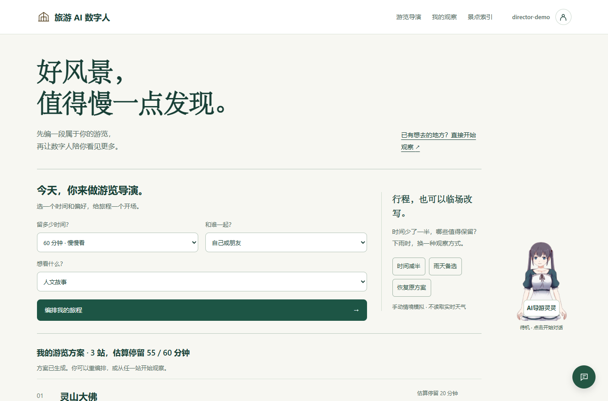
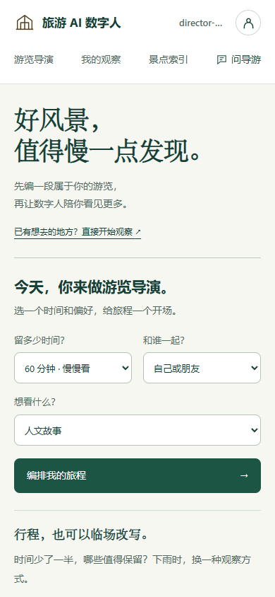
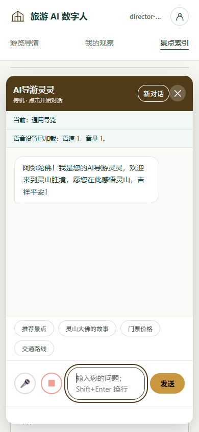

# 游览导演与观察体验

## REQ-043：可解释的情境编排（#29）

用户确认优先实现游览导演，再强化观察，最后统一界面。游客选择30/60/90分钟、同行人及兴趣，纯本地规则从景点API实际返回的候选中选1–4站。“轻松少站”最多2站。“时间减半”“雨天备选”各从上次主动生成的原始设置推演，显示相对上一版保留和移除的站点；恢复原方案不受连续点击影响。

7个候选的停留分钟、室内候选和偏好权重为课设编排标签。估算不含步行、排队、演出等待，站点顺序不是地图导航；雨天是手动模拟，不读取实时天气，不保证室内避雨条件或开放。无匹配时明确为空，可增加预算或恢复原方案；不编造其他景点。方案不保存个人信息、不调用模型、不额外收费。

实现：[director-core.js](../src/main/resources/static/js/director-core.js#L1) 是纯规则与差异模块；[director.js](../src/main/resources/static/js/director.js#L1) 只负责表单、纯文本展示和显式跳转。每站的问导游按钮带真实spotId调用既有GuideChatDraft，用户确认后才发送；忙碌、未同步、已有草稿时保留原输入并说明拒绝原因。

## REQ-044：观察辅助与衔接（#30）

方案的“去观察”只聚焦当前内容包匹配的站点。切站先保留未保存输入；没有对应任务时提示，不切换/导入内容包。新增“我看到／我的猜想／还想核对”写作辅助，只插入可编辑提示，不生成事实、不保存记录；只有提示词的文本不能作为发现保存。保留先观察再展开参考、来源状态、课堂/现场模式和本地记录边界。

实现：[exploration.js](../src/main/resources/static/js/exploration.js#L1)，新增GuideExploreSpot供旅程模块调用；记录、对照、导出继续使用现有core，个人观察不写入公共知识库。

## REQ-045：游客界面（#31）

这是对既有绿色/纸白观察界面的扩展与美化：顶栏导航、清晰的编排输入、站点说明、观察工作区及可读景点索引。替换旧的大色块emoji卡片，数字人桌面缩小，手机保留聊天入口并避免遮挡表单；不改后台皮肤和模型素材。新图标为简单几何SVG，不增加需要确认授权的景区照片。延续既有中文衬线标题/系统正文，避免新增字体网络依赖。

实现：[tour-experience.css](../src/main/resources/static/css/tour-experience.css#L1) 在既有样式后加载，主题设置仍用于导游/聊天与焦点。支持reduced-motion、键盘按钮和390px宽布局。产品上下文见 [PRODUCT.md](../PRODUCT.md#L1)。

## API-043：复用现有接口

不新增HTTP接口。GET /api/spots作为可选景点来源；现有POST /api/chat只在用户主动发送草稿时调用，继续传Cookie、CSRF、conversationId和可选spotId；400/403/410及会话限制不变。请求例为 `{"message":"我计划观察灵山大佛，请给我一个观察建议。","spotId":11}`。后端定位见 [ChatController](../src/main/java/com/guide/controller/ChatController.java#L24)。

## TEST-043/044/045：验收

[director.test.js](../tests/frontend/director.test.js#L1) 检查预算/最多站数/无API候选/非法输入/稳定排序/雨天情境/差异，以及按钮不自动提问、拒绝已有草稿和内容包无匹配的反馈。[exploration-page.test.js](../tests/frontend/exploration-page.test.js#L1) 检查跨站未保存草稿、写作提示不自动记录、空提示不可保存。完整命令 `node --test tests/frontend/*.test.js`；失败时检查纯规则和API候选映射、当前内容包、手册就绪与草稿状态。

运行 `mvn -o verify`、`python scripts/check_doc_links.py` 和隔离JAR HTTP冒烟。桌面1365×900及手机390×844验收：生成/减半/雨天/恢复、进入观察、写作辅助、搜索和聊天。浏览器无横向页面溢出；样式用技能检测器和独立截图复查。真实模型、景区实测和Android真机不在本次验证中。

## 实际验证记录

2026-11-02：Java221/221、Node160/160、文档链接与隔离JAR HTTP冒烟通过。Edge1365×900/390×844实际验证情境重排、观察跳转、写作提示、草稿交接与聊天。手机页面scrollWidth=390；聊天输入区底部793px、发送按钮底部769px均处于844px视口内。

独立代码复查修复了点击冒泡导致聊天关闭、JS滚动不遵守reduced-motion；视觉复查列出的手机聊天裁切、入口覆盖正文和站名/状态挤排三项均被评分resolved，最终disposition为ship，结论范围限于这些修正。检测器运行一次；旧modal全幅头图和真实请求等待圆点保留，新的退出按钮对比与浮动阴影已修正。

