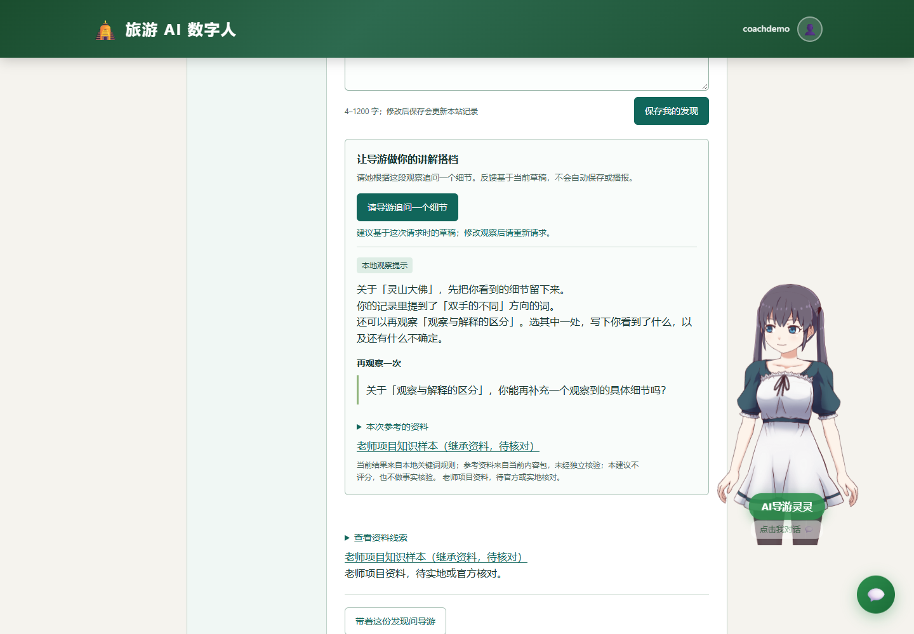
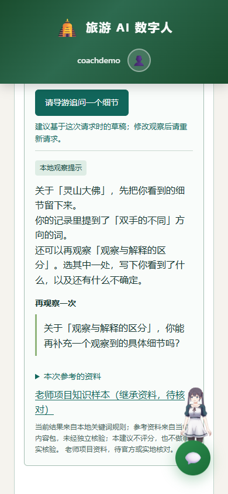

# REQ-033：讲解搭档与有边界的模型调用

用户要求继续改进。本轮补足观察任务到数字人反馈的交互，更新现有创意 PR #18，不另堆叠功能分支。基准提交为 5135e3690503ccccb6ac121c3f31b1f78726fa85。

## 产品决定

写下发现后可点击“请导游追问一个细节”，无需先保存。系统根据当前任务、个人观察和资料线索返回一段建议与一个后续观察问题，页面以“讲解搭档”展示，来源与正文分开。反馈不评分、不确认游客已到访、不将个人观点写进公共知识。它补充已有聊天草稿交接，不自动发送聊天或强制播报。

无 Key 时使用本地关键词规则，标注“本地观察提示”；配置 Key 后尝试模型建议，标注“模型建议，尚未核验”。模型失败、空响应或超时自动降级本地提示，仍标清来源；不能宣称所有建议都来自模型。默认不调用外部来源 URL，不能把包作者提供的链接当作独立检索核验。

## API-033 POST /api/exploration/coach

请求：`{packId,packVersion,task:{id,spotName,title,prompt,reference,source:{title,url,status},cues:[{label,terms}]},observation,mode}`。字段来自当前校验后的内容包；observation trim 后4–1200字，mode为demo/onsite。

校验：必须为对象、字符串必须是真字符串；packId/packVersion/task.id 使用既有 ID 规则；spotName≤80、title≤100、prompt≤600、reference≤1600、source.title≤150、source.url≤1000且为无userinfo的https URL，source.status为inherited-unverified/original-demo；cues为1–6组，label≤80，每组terms为1–10个非空词≤40。请求最大正常文本总量受上述边界控制；不接收任意系统指令、接口地址、模型 ID 或服务器文件路径。

成功HTTP200：`{reply,followUp,mode,fallback,reference,source,notice}`；mode为local-coach/model-coach，fallback为布尔值，reply为非空纯文本≤2400，followUp≤160。reference/source始终来自本次有效请求，模型不能覆盖引用。notice说明来源由内容包提供、未经独立核验、建议不判分。400返回`{code:"INVALID_CONTEXT",message:"中文原因"}`，不回显完整观察。畸形JSON返回相同错误码。

后端不记录本次个人观察到analytics或用户数据文件。已有认证PR #15仍独立，页面若有AuthGuard则使用其apiFetch，保留CSRF兼容，不绕过服务端认证。

## 后端设计与验收

抽取 AiCompletionClient 作为已有聊天与新搭档的共同供应商调用边界。保留 ai.api-key/base-url/model 配置，连接上限3秒、读取上限15秒；不自动重试，模型异常/空白回复由各业务服务明确降级。RestTemplate可注入进行假服务测试；任何自动测试不得调用真实模型。旧 /api/chat 的响应字段和离线语义不变。该超时是连接/读取时限，不声称严格的整体模型计算截止时间。

搭档本地回复只描述当前观察，未提到的关键词标签成为下一步观察方向；已提到不代表正确。模型system只规定当前任务反馈，客户端任务/资料/观察放在user数据中明确标为未核验输入，不得覆盖系统规则。回复长度受限，服务器日志不输出Key、个人观察或供应商完整响应。

后端检查覆盖：有效与非法字段、原型样式ID、不安全URL、畸形JSON、无Key本地、假模型成功/空/错误降级、源字段不可被模型覆盖、旧chat离线回归、传输超时配置。新增spring-boot-starter-test，仅test作用域，与 #15 相同依赖便于后续合并。

## 页面行为与验收

1. 点按钮读取当前编辑区，允许未保存观察，明确反馈基于当前草稿，不自动保存。空/过短输入在本地提示。
2. 单个搭档请求进行中按钮禁用，旁边有取消。20秒总等待，覆盖网络与JSON解析；迟到成功/错误均忽略。主聊天和搭档各自等待，不混用取消或自动播报。
3. 切站、切包、编辑讲解、切换记录方式后使旧反馈失效并取消等待，不能把上一段建议显示在另一站。需要时重新点击，不能自动新增付费调用。
4. 反馈含建议、追问、引用原文、来源链接及来源状态、真实生成方式。全部按文本渲染，不执行返回HTML。非成功HTTP/网络失败显示可重试提示并恢复按钮，保留原观察。
5. 仍可保存、导出旅程、导入包和使用原聊天草稿入口。当前首版不把搭档建议永久写入手册，不伪造长期记忆或评分。

## 交付证据

执行Java测试/构建、已有与新增前端行为测试、文档链接及隔离JAR HTTP检查；浏览器验证默认无Key提示与上下文失效，保存截图。真实模型、Android真机和实地事实核验仍需单独验收。

## 验证记录（2026-10-26）

- Java共67项、前端共62项测试通过；模型路径由假供应商验证，无真实付费模型调用。Codex亲自执行过离线Maven verify、前端全量测试、最终JAR的隔离HTTP检查，并复查实际修改。
- 无Key HTTP验证包括讲解建议/后续问题、来源与引用保持、非法短观察400；原聊天与Live2D检查继续通过。
- 浏览器在1440像素桌面与390×844窄屏验证：未保存草稿可请求；进度仍为0/3；改写隐藏旧建议、切站隐藏反馈、切回保留草稿；重新请求才出现新建议。
- Standards轴无硬规则或维护性发现；Spec轴未发现确定缺失或越界。Codex额外修正了失败降级的“未调用模型”虚假文案、无效URL端口校验，并精简正文重复说明。
- 依赖在本机已缓存，联网解析受限时使用mvn -o verify；GitHub CI使用常规mvn verify。真实模型、Android与现场资料核验仍未验收。

