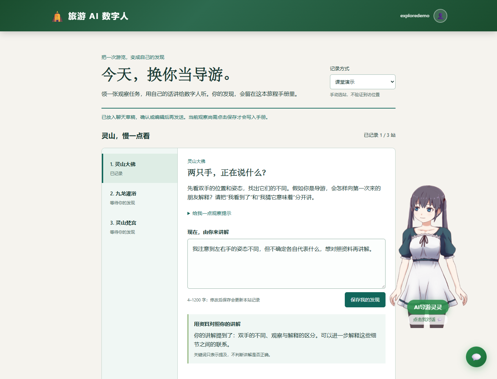
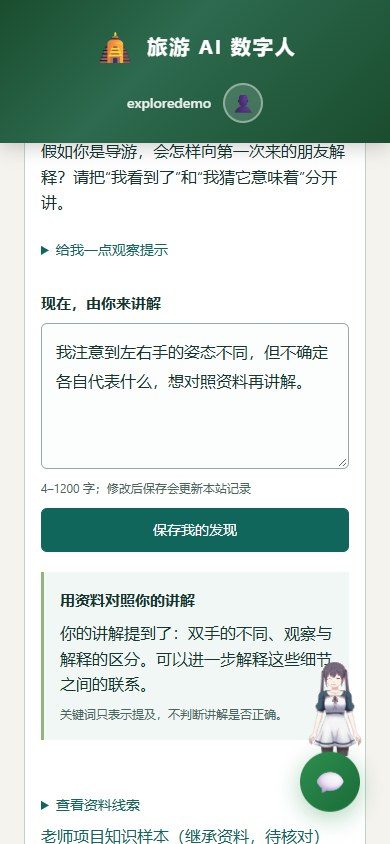

# 今天你当导游：体验、复用与答辩

对应 REQ-032、[GitHub #17](https://github.com/D92647426/tourism-ai-avatar/issues/17)。设计与验收见 [exploration_design.md:L1](./exploration_design.md#L1)。这是可体验的课设首版，不承诺具体分数。

## 90 秒演示

1. 首页选择“课堂演示”，在灵山大佛站领取“两只手，正在说什么？”任务。
2. 写下自己的观察，如“我注意到两只手的姿态不同，但不确定各自代表什么”，保存。
3. 展开资料：个人原话与待核对资料分开展示。关键词对照不代表正确性或得分。
4. 点击“带着这份发现问导游”，确认聊天草稿含景点、任务、个人观察和来源，可编辑后发送；已有草稿或进行中的请求不会被覆盖。
5. 下载旅程手册，展示只含实际记录的一站、课堂演示标签和来源说明。
6. 下载校园示例包，选择 JSON、预览并确认使用。任务变成校园树、建筑和小路，无需改 Java。重新导入相同 ID/版本的原包可恢复已保存记录。

没有模型 Key 也能完成任务、关键词对照、保存、导入导出。已有聊天的离线降级仍是基础景点匹配，**不会因此变成理解个人讲解的模型反馈**；真实模型回应需另配服务商 Key 并单独验收。

## 和老师基线的区别

| 老师项目继承能力 | 本轮新增 |
|---|---|
| 景点列表、知识问答、Live2D、Android 桥接 | 游客主动观察与反向讲解流程 |
| 固定景点知识 | 可校验任务内容包与校园示例 |
| 单次问题入口 | 当前发现与资料来源到聊天草稿的交接 |
| 问答记录 | 本机按账号和内容版本隔离的旅程、可下载手册 |

成员可分别在任务设计、数字人追问措辞、新景区内容包和真实试用形成有效贡献。两份示例注明 AI 辅助，不把 AI 产出冒充独立人工成果。

## 内容包约定

完整例子：[lingshan-demo.json:L1](../src/main/resources/static/exploration/lingshan-demo.json#L1)、[campus-demo.json:L1](../src/main/resources/static/exploration/campus-demo.json#L1)。

| 字段 | 类型与边界（全部必填，无隐式补齐） | 用途 |
|---|---|---|
| schemaVersion | 数字，固定 1 | 格式版本 |
| id / version | 1–64 位，以字母/数字开头，仅含字母、数字、点、下划线、连字符 | 记录命名空间；改变任务含义时增加版本，不复用别组 id |
| title / author / licenseNotice | 非空文本，上限 80 / 100 / 600 | 标题、署名与素材说明，不授予原始资料的新权限 |
| tasks | 1–12 项 | 顺序为目录，不是导航路线 |
| task.id / spotName / title | id 同上且唯一；名称≤80，标题≤100 | 任务标识与显示 |
| task.prompt / hint / reference | 非空文本，≤600 / 600 / 1600 | 问题、提示、资料线索 |
| task.source | title≤150，url≤1000且为无账号密码的 https；status 为 inherited-unverified 或 original-demo | 来源及核对状态；源链接可能需要仓库访问权限 |
| task.cues | 1–6组，label≤80；terms 每组1–10个非空词，词≤40 | 明示子串匹配，不判断语义、真假或成绩 |

未知字段丢弃。页面限制文件 128 KiB，规则限制规范化 JSON 131072 字符。文本不作为 HTML 执行；Markdown 导出也转义内容。相同包 ID/版本共享记录，作者应增加版本来隔离修改后的任务。

## 保存和边界

- 当前包/站点：`tourism-explore:v1:<userId>`；记录：`tourism-journal:v1:<userId>:<packId>:<version>`。实现见 [exploration.js:L16](../src/main/resources/static/js/exploration.js#L16)。
- 一站保留最新已保存讲解，重复保存不增加进度。切站保留当前页未保存草稿，刷新仅恢复已保存记录。更换包前须处理各站未保存草稿。
- 模式只影响之后保存的记录，不把旧课堂记录改成到访。现场模式也是个人自述，没有定位证明。
- 存储禁用或容量不足时提示，当前页仍可体验和下载，刷新可能丢失。清理浏览器数据会删除记录。
- 当前是本机数据隔离，不等于安全认证、加密或跨设备同步。不要记录身份信息、个人行踪等敏感内容；权限修复另见 PR #15。
- 默认景点资料来自老师样本，待官方/实地核对，来源授权尚待确认；任务目录不是导航，不提供实时开放时间。

## 关键位置与检查

| 边界 | 位置 |
|---|---|
| 校验、记录、恢复、对照、草稿、导出 | [exploration-core.js:L1](../src/main/resources/static/js/exploration-core.js#L1) |
| DOM、存储、导入预览、下载 | [exploration.js:L51](../src/main/resources/static/js/exploration.js#L51) |
| 聊天草稿交接 | [main.js:L274](../src/main/resources/static/js/main.js#L274) |
| 页面/样式 | [index.html:L28](../src/main/resources/static/index.html#L28)、[exploration.css:L1](../src/main/resources/static/css/exploration.css#L1) |
| 测试 | [exploration-core.test.js:L1](../tests/frontend/exploration-core.test.js#L1)、[exploration-page.test.js:L1](../tests/frontend/exploration-page.test.js#L1)、[chat-main.test.js:L1](../tests/frontend/chat-main.test.js#L1) |

执行 `node --test tests/frontend/*.test.js`、`mvn verify`、`python scripts/check_doc_links.py`、`python scripts/smoke_teacher_project.py --jar target/ai-guide-1.0.0.jar`。导入失败先看具体字段提示；存储失败先下载手册，不要求清空数据排错。

## 本轮验证记录（2026-10-26）

前端共47项检查通过。浏览器在1440×1100与390×844验证：保存一条观察、准备含换行的聊天草稿；导入校园包先预览再确认，重新导入灵山包恢复1条记录。窄屏数字人缩为角落角色，窗口变化后重新适配画布；长草稿使用可编辑多行框。

规则实现由 DeepSeek Harness 按 Codex 已定接口完成，Codex复查、反馈修正日期验证并完成页面与集成验证。评审发现的来源隐藏、空白误判未保存、存储失败切包丢记录均已修复并回归。真实模型、Android真机与现场观察未验收。
