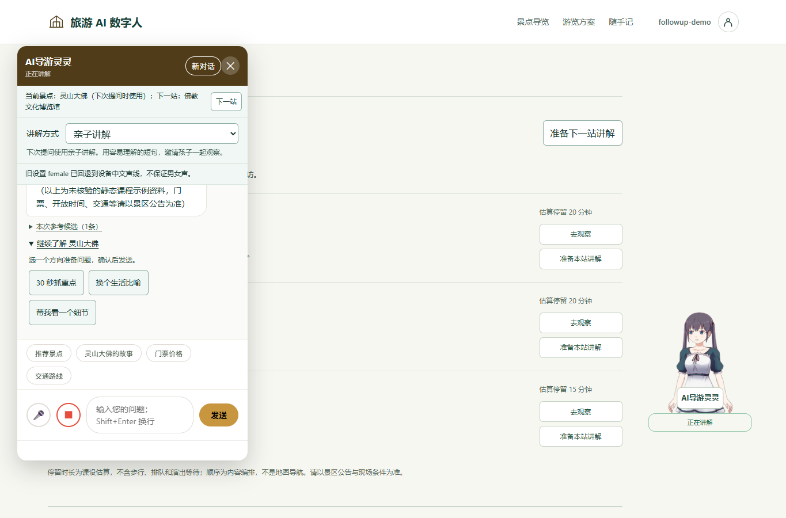
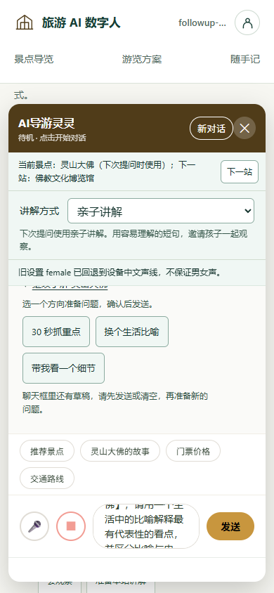

# 导游追问卡

## REQ-049 与议题 #42

游客听完一站后可以准备三个方向的问题，抓重点、换比喻、看细节。卡片在每条有有效景点的成功回答下，使用原生折叠区并标注该回答的景点名。点击只准备可编辑草稿，游客确认后发送。问题使用固定模板，继续沿用当前讲解方式。

每张卡片绑定当次响应的真实景点 ID 和名称。点击历史卡片会显式选择该景点。同一当前方案站保留下一站接力，选择其他站退出原接力。重编后点击旧卡片属于显式重新选站。草稿、忙碌、重置或未同步时复用统一守卫并显示原因，接受后才更改上下文。取消或迟到响应由现有请求生命周期拦截。

通用回答和未知景点没有卡片。卡片名称和反馈使用纯文本。比喻问题要求区分比喻和史实，观察问题要求资料不足时说明。候选资料仍独立展示待核验状态。卡片只提供提问入口，实际文风和事实需要另行验证。

## 接口与实现

API-049 复用 POST /api/chat，message 为带景点名称的问题，spotId 为当次卡片绑定的真实 ID，conversationId 与 narrationMode 使用当前会话值。既有 400/403/410/502 契约沿用。无新增后端字段、管理配置、存储或依赖。

GuideChatFollowups.append(document, parent, spot, prepare) 验证景点并复制 ID/name，创建三按钮和局部 status，调用 prepare(text, spotId)，返回折叠节点或 null。main.js 将响应 spotId 与加载的景点表匹配，调用既有 GuideChatDraft，并按当前方案站判断 tour 来源。模板与按钮文案集中于模块内修改。

实现入口为 [追问卡渲染器](../src/main/resources/static/js/chat-followups.js#L1) 和 [主聊天](../src/main/resources/static/js/main.js#L1)。

## 视觉与交互

沿用现有白色 #fff、墨绿 #16352f、湖绿 #11665b、浅绿 #f0f7f4 和边线 #d1ddcf。保留现有正文系统字体与页面中文衬线标题。回答正文、参考候选、追问折叠入口依次左对齐，卡片只在消息区内展开，按钮可换行且触控高度至少 44px。焦点清晰可见，状态通过 polite live region 反馈。

设计检查后保留页面既有层级，将三项操作收进折叠区，避免每条回答重复铺开按钮和说明。验证桌面、390px 手机、短横屏的滚动、文字换行与发送可达。

## TEST-049 验收计划

[模块测试](../tests/frontend/chat-followups.test.js#L1) 验证无效景点、固定模板、纯文本名称、历史快照与拒绝反馈。[真实主页面联动](../tests/frontend/followups-page.test.js#L1) 验证显式草稿、无自动发送、模式继承、多站历史选择、忙碌与草稿保护、重编、通用回答与迟到请求。

运行 node --test tests/frontend/*.test.js、mvn -o verify、python scripts/check_doc_links.py 和隔离 JAR HTTP 冒烟。截图与规范、需求双轴审查完成后记录实际结果。以 PR 状态区分提交和合并。

## 实际验证

Java 228/228、Node 185/185（新增 9 项）、文档链接与隔离 JAR HTTP 冒烟通过。HTTP 检查包含新脚本资源与既有跨站会话契约。运行未配置模型密钥，实际回答使用本地资料，真实模型对比喻和观察问题的生成效果仍需单独验收。

Edge 1365×900 下点击“换个生活比喻”仅生成本站草稿，保留 family 与灵山大佛接力选择。再点另一追问显示草稿拒绝，原文保持。390×844 页面宽 390px，追问按钮高 44px，输入底部 781px、发送底部 769px。844×390 页面宽 844px，输入底部 331px、发送底部 319px。均可在消息区滚动展开。

## Standards

以 c1d8c18 为固定基点进行独立规范复查，0 项发现。独立运行新增测试 9/9 通过。主聊天复用既有守卫，需求/API/程序/测试索引均已同步。

## Spec

独立需求复查 0 项发现，运行新增测试与已有旅程/候选回归共 18/18 通过。真实模型生成效果仍按实际验证记录另行验收。此次 AI 复查不计为组员人工评审。

追问卡范围 axe 检查 13 项通过、0 违反、0 未完成。提交见 [PR #43](https://github.com/D92647426/tourism-ai-avatar/pull/43)，状态为已提交待合并，议题 #42 保持开放。

## 后续本地回应

前述生成效果边界为本轮 #42 的验收记录。后续 [REQ-050](local_followups_design.md#L1) 为三个固定问题补齐确定性的本地组织，并将“30 秒抓重点”改为“抓重点”。自由改写问题和真实模型仍按各自问答路径验收。
