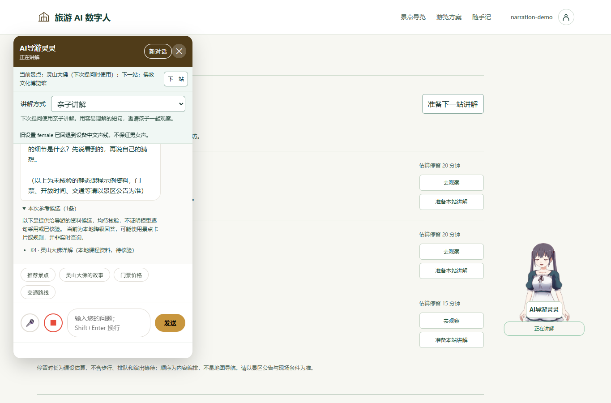
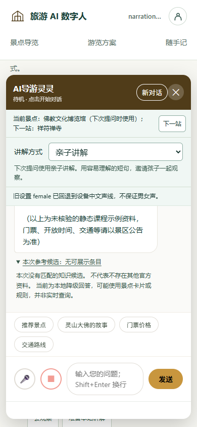

# 游览讲解衔接与参考候选（#38 / #39）

## REQ-047：从方案接着听

从#37讲解方式所在main开发。方案每站提供“准备本站讲解”和可选“去观察”；游客主动选择后将介绍问题放入既有草稿，显示待讲解站/下一站，不自动发送、不暗示到访、完成或真实导航。聊天当前景点行显示下一站并提供准备按钮，最后一站没有下一站，不循环。

方案状态只在当前页面内存保存，刷新重新编排且不自动认领服务端当前景点；讲解方式继续由现有会话恢复。纯journey-core模块保存最多4站的真实ID/name和选中站，输出脱离内部状态的快照；无文件、网络或本地存储。

重编、减半、雨天、恢复均替换方案并清空讲解选择，既有差异说明保留/移除站点。若聊天来自该方案，清除旧重试、取消等待/旧播报和语音输入，保留草稿，阻止继续套用旧站；重新选有效站或新对话后可继续。取消不能撤销已经到达服务端的请求，不宣称服务器未处理。重新选同一景点可沿用历史，不同景点由既有spotId契约清理历史。切换讲解方式保留方案选择。

已有草稿、忙碌、会话未同步、无方案/无下一站或未知ID时不变更当前站，显示可恢复原因。主导览聊天HTTP400要求修正问题或刷新选站，不原样重放；观察搭档保留旧错误契约。详情主动选其他景点、新对话或成功回答切到其他景点时退出方案讲解；不自动选择另一站。清除方案阻塞仅允许显式选站/新对话，不靠旧重试恢复。

接口边界：journey-core.create()提供replace(stops)/select(id)/clear()/snapshot()；replace无效参数抛TypeError且不修改旧状态，select未知ID返回false。journey.js页面适配提供GuideTour.replacePlan/prepare/syncSpot/clearSelection/snapshot，只有prepare主动调GuideChatDraft(text,{spotId,tour:true})。main.js提供方案失效回调及既有草稿守卫，服务端API不增加字段。

## REQ-048：每次回答自己的参考候选

复用响应knowledgeReferences。每条成功回答旁有可展开的“本次参考候选”，只显示该响应内有效、去重的最多3条本地候选。id必须正安全整数、title为非空字符串（显示上限80字符）、source必须精确为local-knowledge:{id}；其他条目不展示，不创建任何可执行或外部链接。

标题与编号使用textContent。所有本地资料均标“待核验”，明确候选只是提供给导游的检索输入，不证明模型逐句采用、官方出处或事实正确。无候选/旧响应未提供候选也有说明；本地fallback另说明可能使用景点卡片/规则，并非实时查询。个人观察不混入公共资料。历史回答的候选不跟随后续回答变化；取消、超时或过时请求不插入新候选。

chat-references.js渲染器负责验证并append到同一次bot消息。无候选也可展开说明；不使用共享“最近资料”全局列表。服务端既有候选生成与快照规则不变。

## API-047 / API-048

GET /api/spots作为真实可选ID。POST /api/chat仍为message/conversationId/spotId/narrationMode/interest，例 `{"message":"请介绍灵山大佛，先讲最值得了解的一点。","spotId":11,"narrationMode":"family"}`。响应既有reply/fallback/spotId/conversationId/narrationMode/knowledgeReferences；候选例 `[{"id":4,"title":"灵山大佛","source":"local-knowledge:4"}]`。400/403/410/502及CSRF沿用，GET /api/chat/context与POST /api/chat/new不变。没有新增管理API/配置/依赖。

## 测试与界面约定

TEST-047：真实ID、上/下一站、空/无效/重复方案不破坏旧状态、快照不被外部修改；实际页面+主聊天联动验证模式沿用、切站请求、草稿拒绝、重编清旧重试、取消后迟到响应无作用、方案外切换与新对话。TEST-048：两次响应不同候选绑定各自消息，恶意标题纯文本、非法source/ID丢弃、重复最多3、无候选和本地提示、取消/迟到不插入候选。

沿用墨绿#16352f、湖绿#11665b、白#fff、浅绿#f0f7f4、边线#d1ddcf及现有字体。方案区是一条选中站/下一站说明与操作，聊天只扩展既有上下文行，不再增高固定工具栏。候选使用原生details放在可滚动消息区域，桌面/390px手机/844×390短横屏均检查发送可达与页面无横向溢出。新文字与按钮均为游客动作，不显示实现术语。

验收命令：Node前端全套、mvn -o verify、文档链接、隔离JAR HTTP冒烟；截图与双轴复查后再合并。真实模型文风、Android和景区事实核验不在本轮。

## 实际验证（合并前）

Java228/228、Node176/176、文档链接和隔离JAR HTTP冒烟通过，包含journey_assets、journey_station_handoff、knowledge_candidate_contract。无真实模型调用。Edge1365×900、390×844和844×390实际验证；最终合并状态以关联PR为准。

Edge验证：灵山大佛→佛教文化博览馆沿用family；最后一站无下一站按钮。重编后点击快捷问题，草稿“保留这句想法”保持原文且仍提示重新选站。桌面候选K4可展开，博览馆无匹配候选也有明确说明，两条回答不混资料。

桌面scrollWidth=1365、发送底部741px；390×844页面scrollWidth=390、输入底部781px、发送底部769px；844×390横屏输入底部331px、发送底部319px。候选在消息区内部滚动可展开，不覆盖发送区。

### Standards

初次与增量独立复查均无发现。共享请求的400纠正只由主聊天显式启用；无新增库、后端接口或未说明的全局配置。

### Spec

发现1项P2（无景点的观察草稿绕过重编阻塞）和1项补充交互风险（快捷问题覆盖保留草稿），均修复并经独立复查resolved，限定范围内无剩余项；独立运行联动测试7/7通过。审查不代替组员人工贡献。

实现：[纯状态](../src/main/resources/static/js/journey-core.js#L1)、[页面衔接](../src/main/resources/static/js/journey.js#L1)、[候选渲染](../src/main/resources/static/js/chat-references.js#L1)、[请求与守卫](../src/main/resources/static/js/main.js#L1)。合并交付：[PR #41](https://github.com/D92647426/tourism-ai-avatar/pull/41)，按用户明确授权在CI通过后合并。

