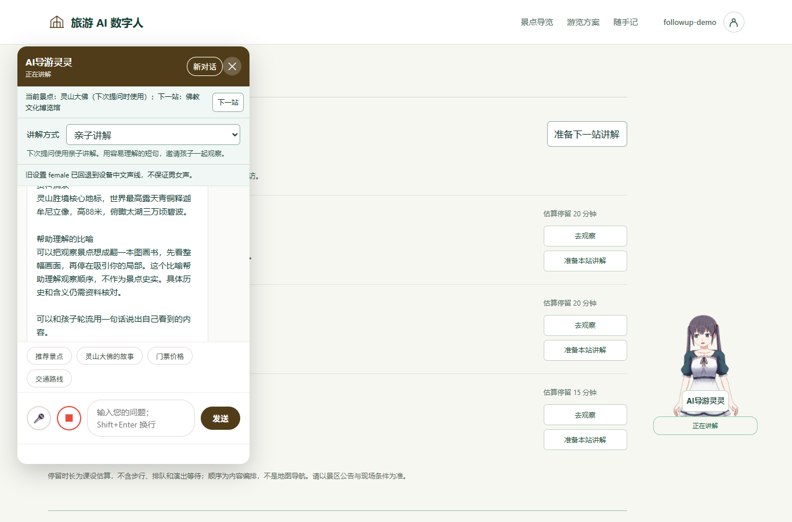
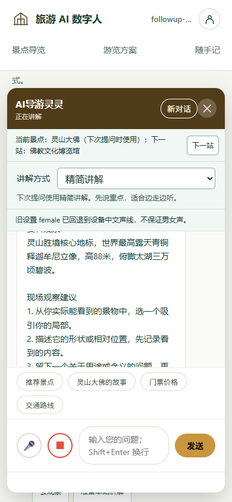

# 本地追问讲解

## REQ-050

依赖 [追问卡](followups_design.md#L1)。旧版在无模型密钥时，三个追问模板返回同一段景点介绍。本轮为固定模板加入可离线验证的讲解组织方式。

只匹配完整问题“关于【实际景点名】，固定模板”。抓重点将完整简介、类别与通用观察方法排成三个部分。比喻先展示简介，再用看图画书类比观察顺序，标明其用途。细节回应先给简介作为资料线索，再请游客选一个实际可见的局部，描述形状或相对位置并留下待核对问题。各部分以资料摘录、比喻、观察建议区分。简介的限定语和缺失状态保留。

前端按钮由“30 秒抓重点”改为“抓重点”。模板正文保留兼容。完整匹配之外沿用原问答逻辑，未承诺开放式意图识别。先执行外景和多实体边界检查，再在已解析的唯一景点或当前景点上匹配模板。显式名字不同的模板不能套用旧景点。三个现有 narrationMode 值沿用，family 增加亲子轮流描述提示。

在线模型仍按原路径优先处理原始问题与历史，失败后进入同一本地回复路径。本地回应附原有静态课程示例提示，候选仍来自当次一次检索快照。

## API-050 与程序

复用 POST /api/chat 的 message、spotId、conversationId、narrationMode，响应 reply/fallback/knowledgeReferences 沿用。请求示例 `{"message":"关于【灵山大佛】，请把核心看点压缩为三句，方便我边走边听。","spotId":11,"narrationMode":"family"}`。返回 fallback=true 且 reply 为分块本地资料。既有 400/403/410/502 契约沿用。

[LocalFollowupReply](../src/main/java/com/guide/service/LocalFollowupReply.java#L1) 负责固定模板匹配和组织已有字段，返回匹配文本或 null；[ChatService](../src/main/java/com/guide/service/ChatService.java#L1) 在既有范围解析后使用，附统一资料边界。模板在此模块与 [前端卡片](../src/main/resources/static/js/chat-followups.js#L1) 同步维护，通过文件契约测试校验。

## TEST-050

[LocalFollowupReplyTest](../src/test/java/com/guide/service/LocalFollowupReplyTest.java#L1) 覆盖三种意图与模式、字段缺失和限定语、真实服务路径、外景/多实体/自定义名称、在线成功与失败、一次候选快照、前端模板契约。隔离 [HTTP 冒烟](../scripts/smoke_teacher_project.py#L1) 验证三模板回答不同且 spot/mode/fallback 一致。

运行 mvn -o verify、node --test tests/frontend/*.test.js、python scripts/check_doc_links.py、python scripts/smoke_teacher_project.py --jar target/ai-guide-1.0.0.jar。PR 以前置 codex/guide-followups 为 base，先合并 PR #43，再将本轮 PR 调整到 main。文档中的已实现与已合并状态分开记录。

## 实际验证

修改前，隔离本地 HTTP 对三个模板得到 3 个 fallback=true 响应，唯一正文数为 1。修改后，隔离 JAR 的 local_followup_replies 检查通过，三个正文不同，景点、brief 和 fallback 字段均正确。

Maven verify 的 Java 236/236、Node 185/185、文档链接、数据结构检查及工具测试 44/44 通过。模型成功/失败仅使用 mock，没有调用真实模型服务。

Edge 实际点击“换个生活比喻”准备并发送，正文出现“帮助理解的比喻”与用途说明，保留 family 和灵山大佛方案选择；切 brief 再点击“带我看一个细节”发送，正文出现三步观察建议，本站接力继续保留。1365×900 页面宽 1365px、发送底部 741px。390×844 页面宽 390px、输入底部 781px、发送底部 769px。844×390 页面宽 844px、输入底部 331px、发送底部 319px。

## Standards

以 dd3220e 为固定基点独立复查，0 项发现。文档链接与前端追问 9/9 独立通过。模块职责、字段保留和追踪索引符合项目规范。

## Spec

以 REQ-050 为依据独立复查，0 项发现。核对完整模板、范围判断、在线优先、故障降级和字段边界，独立运行前端追问 9/9，检查实际 Java 日志及覆盖。AI 审查不计入组员人工贡献。

交付 [PR #45](https://github.com/D92647426/tourism-ai-avatar/pull/45)，关联 [#44](https://github.com/D92647426/tourism-ai-avatar/issues/44)，已提交待合并。先合并前置 [PR #43](https://github.com/D92647426/tourism-ai-avatar/pull/43)，再将本 PR base 从 codex/guide-followups 调整为 main 并复核 CI。
