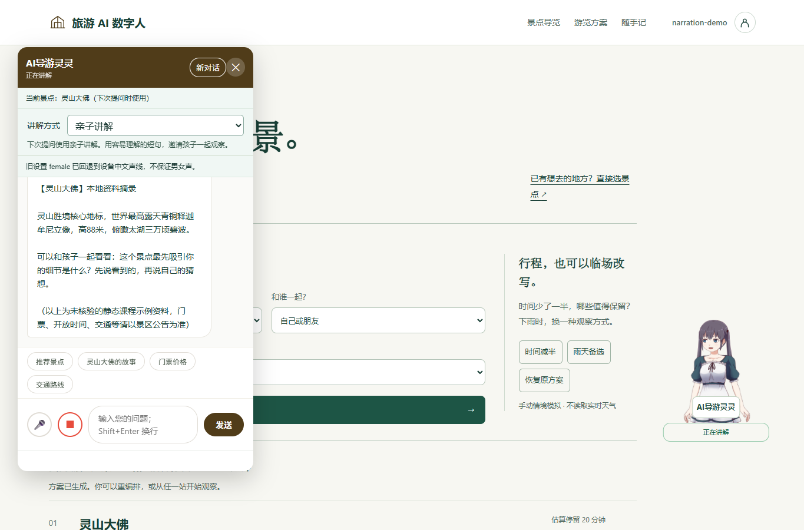
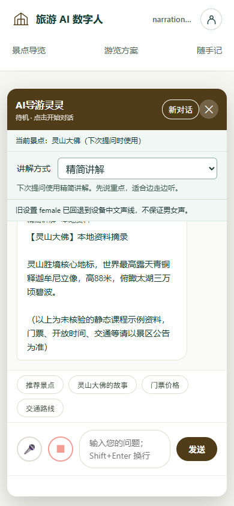

# 面向游客的讲解方式（REQ-046）

## 主题与范围

用户确认继续“景区导览服务 AI 数字人”主题。主线是选景点、听讲解、连续提问与个性化游览。推理剧情、AR 和共享证据板退回备选；不安装新引擎。现有观察记录继续作为自愿补充。

## 产品行为

游客在聊天中选择标准讲解 standard、亲子讲解 family、精简讲解 brief。切换只设置下一次提问方式，不自动发送、不覆盖草稿、不修改兴趣或语音参数。切换会停止旧播报/语音输入、移除旧重试快照；请求中或新对话重置中不可切换。回答标出该次讲解方式及本地降级状态，历史回答不随选择改名。

偏好仅属于当前 HTTP Session/身份的一次对话。成功回答后才提交偏好；省略字段沿用本会话偏好，新访客/过期/身份切换/新对话为 standard。切景点保留方式；换方式保留当前景点和历史。刷新通过既有 context 接口同步，不在 localStorage 写年龄、身份或长期偏好。

## API-046

复用 POST /api/chat，增加可选 narrationMode 字符串，值仅 standard/family/brief，显式空串或其他值返回400且不修改会话。例：`{"message":"介绍一下这里","spotId":11,"narrationMode":"family"}`。成功响应增加 narrationMode，其他字段不变。GET /api/chat/context 和 POST /api/chat/new 的快照也增加该字段；没有有效会话时为 standard。

400无效模式/消息/景点，403会话归属不符，410会话过期，502空回复；CSRF 和主体隔离沿用原接口。旧客户端省略字段可用。模式不是服务端全局配置，没有新增管理API或配置字段。模式允许值/提示文字在 NarrationMode 修改，布局与文案在 main.js/index.html 修改。

## 在线与本地回答

在线模型系统提示加入经过白名单解析的方式：standard 延用200–300字自然介绍，family 建议120–200字、短句、解释术语、一个可选观察问题；brief 建议60–120字、先回答最重要的问题。长度是提示目标，不承诺模型严格执行；三种方式都不得编造故事、删去不确定性或假装实时信息。模型请求验证用本机 HTTP mock，不借其结果宣称真实模型文风质量。

无Key/模型失败时，standard 保持原回答；family/brief 对明确的单景点或当前景点采用已有字段：历史、开放、门票、交通问题优先返回相应字段，明确单景点的一般介绍返回 brief。裸追问采用保守规则表（如“免费吗”“有什么特点”），明确指向外景或无法确认指向时不继承当前景点事实，提示范围或补充名称；不是开放域地名识别。family 在一般介绍后附一个不预设景点事实的观察问题，brief 省去完整卡片的次要栏目。字段缺失明确说明；字段不作生硬截断，保留未核验课程资料提示。多景点或无当前景点沿用现有引导，不把局部匹配强行认作当前景点。候选引用仍只表示检索输入，不代表每句话已核验。

## 界面与验收

沿用白底墨绿、中文衬线标题/系统正文。首页标题和入口突出景点与数字人；观察介绍明确可选。聊天新增原生 select 和一行下一次提问的说明，保留手机输入/发送区，键盘焦点可见。无新字体、图片或库依赖。

TEST-046：服务端覆盖默认/沿用/显式重设、刷新快照、切站、重置、过期/身份/浏览器隔离、非法值和失败不提交；本地回答覆盖同景点不同形式、实际字段缺失和问题优先；模型mock验证模式放入system且保留资料边界/历史。前端验证不自动发送、不丢草稿、忙态禁用、切模式废弃旧重试、刷新与新对话同步。隔离JAR HTTP覆盖三种模式、非法值、Cookie隔离和重置。浏览器检查1365×900/390×844输入区可达并截图。

实现定位和实际验证在交付时追加；当前设计不承诺真实景区资料已核验或Android真机已测试。

## 实现与验证记录

2026-11-02：Java227/227、Node162/162、文档链接与隔离JAR HTTP冒烟通过，HTTP包含narration_modes/session_restore/invalid_rollback/reset。模型仅使用HTTP mock或模拟故障，不代表已验收真实第三方模型的文风。

Edge实际操作验证亲子→精简、不覆盖草稿、刷新保留family、重置standard。1365×900桌面消息区域高约288px、发送按钮底部741px；390×844页面scrollWidth=390，输入底部781px、发送底部769px。保留口型/播报已有行为，未验Android真机或景区事实。

实现：[白名单](../src/main/java/com/guide/model/NarrationMode.java#L1)、[会话候选](../src/main/java/com/guide/service/ConversationService.java#L78)、[模型与本地组织](../src/main/java/com/guide/service/ChatService.java#L78)、[页面同步](../src/main/resources/static/js/main.js#L235)。测试函数与命令见 [TEST-046](test_reference.md#L1)。

复查修正：初始化恢复以代际作废，迟到的景点/会话请求不能覆盖新对话；新对话未确认时保留草稿并阻止发送，重试确认后恢复。外景先判断资料范围，免费/特点等短追问有回归；500px以下短屏隐藏快捷问题和模式说明，保留输入及选择。
