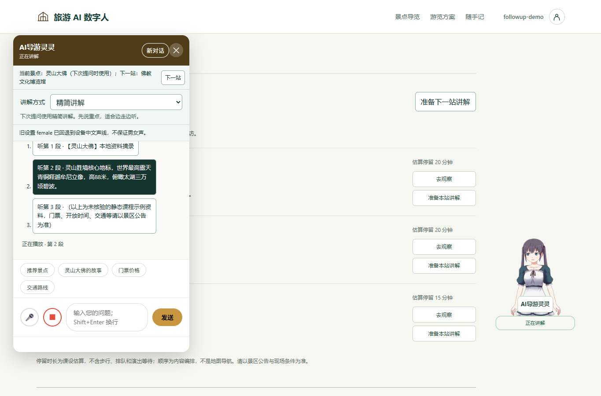
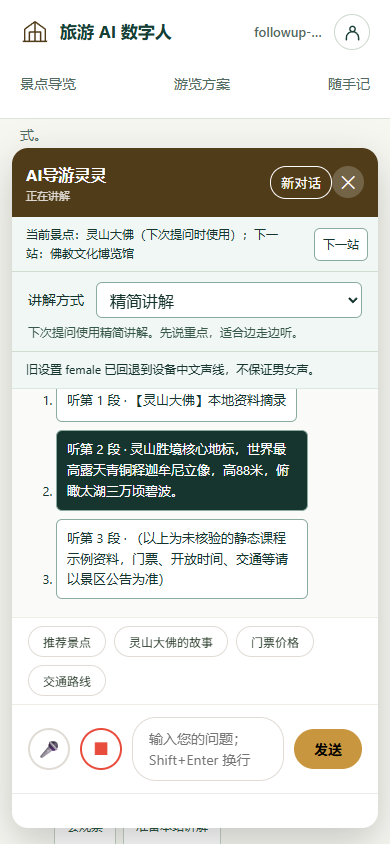

# 按段听讲解

## REQ-051

先按用户授权合并 PR #43 与 #45，主线继续为景区数字人导览。本轮让游客在历史成功回答下重听全文，或只听想了解的一段。每条回答提供原生折叠区、全文按钮、分段按钮和停止本条播报按钮。段落依据空行，最多12段，余文合入末段，保留完整内容。单段只提供全文重听。

原有新回答自动播报沿用。点击回听使用该条回答的正文快照，保留当前草稿、景点、模式和方案，不调用聊天 API。正在请求、重置或会话尚未同步时拒绝并在原卡片反馈。回听停止当前语音识别及待发送语音计时，保留识别文本。一段播完后由游客选择后续内容。

## 状态与接口

API-051 为浏览器内部 GuideAudioCard.append(document,parent,text,callbacks)，返回卡片控制句柄或 null。callbacks.play(text,card,index) 返回 accepted/reason，callbacks.stop(card) 停止对应播报。index=-1 表示全文，其余为从0开始的段落。句柄 render(state,index) 更新真实状态、按下标记与停止按钮。模块只负责安全 DOM 和段落快照。

主聊天只持有当前播报卡片及段落下标。切换时先停止旧任务并重置旧卡片，新的 queued/speaking/paused/idle/error 跟随既有 GuideSpeech。新请求、草稿交接、模式切换、重编、关面板和后台均沿用原停止入口。旧引擎事件仍由生命周期识别，失败保留文字并可再次点击重听。纯标题或链接经播报清洗后为空时，在停止旧播报前拒绝并给出局部原因。既有声线、语速和0音量设置继续使用。

[chat-audio.js](../src/main/resources/static/js/chat-audio.js#L1) 负责分段与卡片，[main.js](../src/main/resources/static/js/main.js#L1) 负责守卫与播放归属，[speech-lifecycle.js](../src/main/resources/static/js/speech-lifecycle.js#L1) 负责真实引擎事件。HTTP API 和存储配置沿用。

## 界面决定

按 frontend-design 技能延续白 #fff、墨绿 #16352f、湖绿 #11665b、浅绿 #f0f7f4、边线 #d1ddcf 及当前系统正文字体。答案正文后提供一个折叠入口，展开后先全文/停止，再按原文顺序列分段按钮与短预览，全部左对齐。段号表达原文顺序，按钮至少44px，状态为 polite live region。

设计复核后保留一个折叠入口，播放操作均在消息滚动区。卡片标记本条播放段，人物与聊天头继续显示现有统一状态。预览可缩短，播放正文完整保留。

## TEST-051

[模块测试](../tests/frontend/chat-audio.test.js#L1) 覆盖分段、合并余文、单段、纯文本、反馈与真实状态标记。[主聊天集成](../tests/frontend/audio-main.test.js#L1) 以可控语音事件验证仅播放所选内容、无额外请求、草稿保持、拒绝忙态、停止/切换/关闭/后台、迟到事件与无声线。

运行 node --test tests/frontend/*.test.js、mvn -o verify、python scripts/check_doc_links.py、隔离 JAR HTTP 冒烟。浏览器实测布局并使用标注的无声 mock 验证 queued/start/end 状态，真实设备声线音质与 Android 真机另验收。截图、双轴复查与实际结果随后记录。

## 实际验证

Java 236/236、Node 199/199（本轮新增14项）、数据结构与工具测试44/44、文档链接和隔离 JAR HTTP 冒烟通过，包含 audio_asset。原有逐站/候选/本地追问契约继续通过。

浏览器使用 [无声 mock](../tests/fixtures/speech-browser-init.js#L1)，补齐设备 voiceURI 并开放 lastText 只读检查。实际点击“听第2段”后，lastText 仅含第2段正文；注入 start 后为 speaking、该按钮按下，当前灵山大佛与 brief 保留。注入 end 后回 idle、按下标记清零、停止按钮禁用。重听全文后可用本条停止按钮返回 idle。此验证证明文本/事件/界面连接，音质和真实设备能力仍需试听。

1365×900 与390×844截图已检查。手机页面宽390px，输入底部781px、发送底部769px，按钮高度至少44px。844×390 页面宽844px，输入底部331px、发送底部319px。操作在消息区内部滚动可达。

## Standards

以9720555为固定基点独立复查。首次1项P2，纯标题段经清洗为空但仍返回接受并中断旧播报。修正为中断前检查，新增全文/段落回归，独立复查resolved，剩余0项；相关测试13/13与文档链接通过。

## Spec

首次独立发现同一P2，清洗后空文本与accepted/reason和失败反馈契约不符。修正后确认全文/段落均提前拒绝并保留原播报/识别/计时任务，独立测试13/13通过，剩余0项。两轴AI审查不作为组员人工评审贡献。

交付 [PR #47](https://github.com/D92647426/tourism-ai-avatar/pull/47)，关联 [#46](https://github.com/D92647426/tourism-ai-avatar/issues/46)，已提交待合并。前置 #42/#44 已按本轮用户授权合并关闭。
