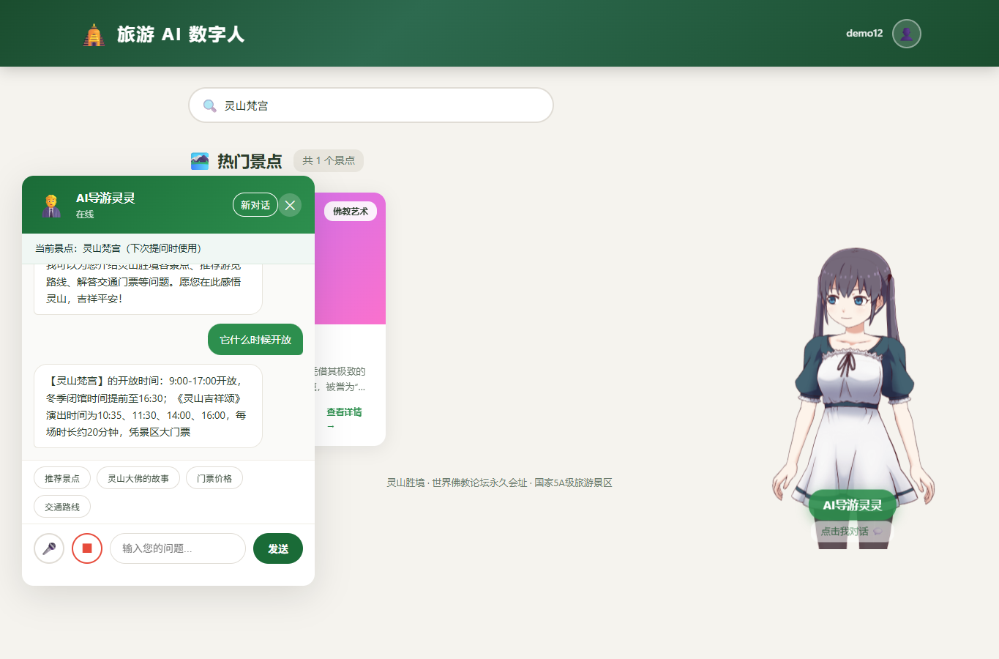
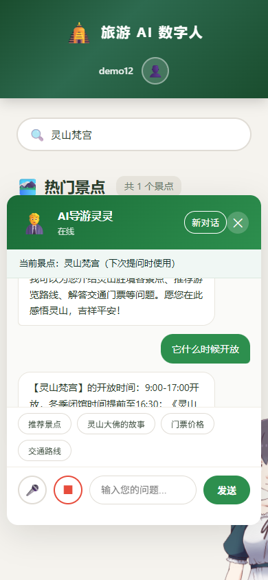

# 景点详情提问入口（Issue #12）

## REQ-040：行为与状态

景点详情底部的“问问 AI 导游”关闭详情并打开聊天，显示所选景点。入口不自动发消息、不清空输入草稿；下一次主动提问才携带 `spotId`，成功后不再固定发送该字段，以便服务端按明确景点名切换。页面加载先通过快照恢复会话与景点，同步失败会阻止发送并提示点击“新对话”。关闭聊天后重开仍显示之前的选择。点击“新对话”成功后清除服务端历史与景点，回到通用导览；失败时保留原选择。正在等待问答或重开响应时禁止再次发送及切换景点，避免旧回复覆盖新选择。

[main.js](../src/main/resources/static/js/main.js#L107) 绑定入口，[上下文标签](../src/main/resources/static/index.html#L94) 用纯文本显示景点，[样式](../src/main/resources/static/css/style.css#L524) 保证按钮至少 44px 高。搜索与详情阅读保留原流程；不涉及 GPS 或地图。

## API-040：复用会话接口

沿用 [API-039](api_reference.md#L82)，新增只读 `GET /api/chat/context`：只返回当前 Cookie 所属会话的 `{conversationId,spotId}`，没有记录、换账号或过期时两字段为 null；不返回消息，不刷新闲置计时。服务实现见 [ConversationService.current](../src/main/java/com/guide/service/ConversationService.java#L60)。发送示例为 `POST /api/chat`，JSON `{"message":"它有什么故事","spotId":11,"conversationId":"服务端返回的ID"}`，响应中的 `spotId` 用来同步展示。Cookie、CSRF、400/403/410 错误码及六轮/20 分钟限制继续适用。

## TEST-040：验收与限制

[spot-chat.test.js](../tests/frontend/spot-chat.test.js#L6) 的第一项测试验证两个景点的真实请求字段、代词追问、重开、通用对话与无自动发送；第二项测试验证忙碌时不能切换或重复发送。命令：`node --test tests/frontend/*.test.js`，预期 32/32；失败时检查 `selectedSpot`、`resettingConversation` 与请求体的 `spotId`。

运行 `mvn -o verify`（48/48）、文档链接检查和无模型密钥的 JAR HTTP 冒烟。Edge 浏览器真实操作验证灵山大佛的故事 → 灵山梵宫开放时间，390×844 手机与桌面截图见下方。真实第三方模型与 Android 真机没有验收。

此分支基于 #11 / PR #25，需在 #5/#6/#11 整合后复测再合入 main。

