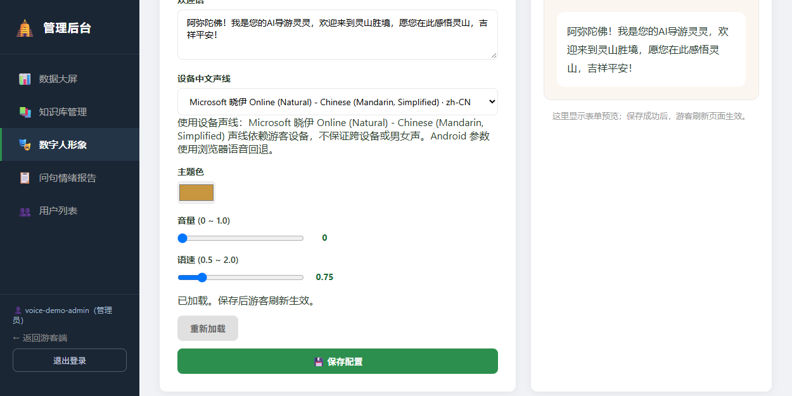

# 语音设置生效（Issue #14）

## REQ-042：行为与范围

管理员设置的 `volume`（0–1，含静音0）、`speechRate`（0.5–2）和 `voiceType` 随配置保存、重载，并通过游客的只读展示接口读取。声线下拉框列出当前设备实际可用中文声线，保存其 voiceURI；异步 voiceschanged 到来后补全列表，并保留当前未保存选择。

`auto` 使用设备默认中文声线。旧 `male`/`female` 保留兼容值并明确说明不保证男女声；保存的 URI 在游客设备不可用时回退到该设备中文声线。没有中文声线时保留文字并显示不可用；不把模型形象当作自带声音。

每个播报任务采样一份参数，Web utterance 实际使用对应 rate/volume/voice，音量0不会被默认值覆盖。状态和口型继续由真实开始/结束/停止回调驱动。当前 Android 协议不支持这些参数，配置播报明确使用 Web 回退；没有浏览器声线时显示文字与错误提示，未声称真机验收。

## API-042 与配置

复用 `GET /api/digital-human-config`（公开只读）和管理员 `GET/PUT /api/admin/digital-human-config`。PUT 例：`{"volume":0,"speechRate":0.75,"voiceType":"auto"}`；成功200返回完整配置，非法类型/范围400，未登录401、无权限/CSRF失败403。服务函数为 [ConfigService](../src/main/java/com/guide/service/ConfigService.java#L1)，已有保存、加载和数值校验继续适用。

voiceType 为非空纯文本、最多200字符；除旧值外支持 `auto` 与设备实际 voiceURI。字段仍是配置标识，不作为 URL请求或 HTML。游客只读路径不调用管理接口。修改范围、默认和兼容策略需同时更新后台、纯模块和播报适配器。

## 实现与 TEST-042

[voice-settings.js](../src/main/resources/static/js/voice-settings.js#L1) 提供配置规范化与设备选择；[admin.js](../src/main/resources/static/js/admin.js#L549) 管理可用列表；[main.js](../src/main/resources/static/js/main.js#L405) 接入公开配置与状态提示；[speech-lifecycle.js](../src/main/resources/static/js/speech-lifecycle.js#L261) 设置实际 utterance。

[voice-settings.test.js](../tests/frontend/voice-settings.test.js#L1) 三项测试覆盖零值/边界/URI回退、实际任务参数和停止隔离、公开配置到页面播报；[display-config.test.js](../tests/frontend/display-config.test.js#L1) 保留后台保存/重载与自定义声线；[speech-main.test.js](../tests/frontend/speech-main.test.js#L73) 检查 Android 参数回退。命令 `node --test tests/frontend/*.test.js`；失败时查公开配置回调、voiceURI是否存在、任务参数快照与设备声线事件。

运行 `mvn -o verify`、文档链接与隔离JAR HTTP冒烟。mock 证明参数传递与状态，不证明扬声器音质、男女声效果、第三方模型或 Android 真机。浏览器截图附在 PR。

Edge 实际设备列表验证：选择中文声线，保存音量0/语速0.75后重新加载，零值和速度保持；截图如下。该操作未播放扬声器音频。

